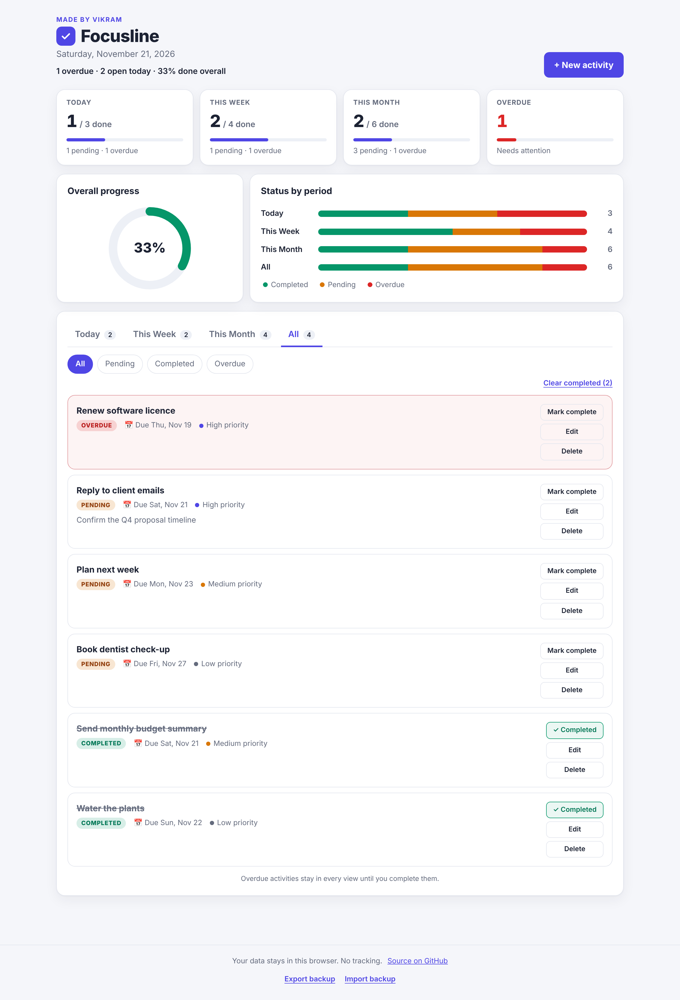
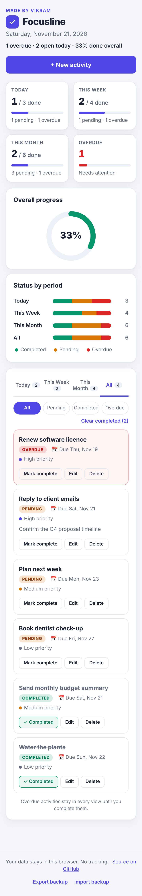

# Focusline

A simple to-do tracker for what you need to do **today**, **this week** and **this month**.





_Screenshots use example data._

- Add an activity with a due date, priority and optional notes.
- Mark it done, or leave it pending. Anything past its due date shows as **overdue** until you finish it.
- Switch between Today, This Week, This Month and All. Filter by Pending, Completed or Overdue.
- The dashboard shows progress for each period. Click a card to open that view.
- Install it on your phone or computer, and it keeps working offline.

## Your data

Activities are saved in **your browser only**. There are no accounts, no servers and no tracking.

Clearing site data or using a different browser or device will not show your activities. To keep a copy, use **Export backup** and keep the file. Use **Import backup** on another device or after clearing data.

## Run it locally

Open `index.html` in a browser. Offline support and installation need the app to be served over `http://localhost` or `https://`, for example:

```bash
cd todo-app
python3 -m http.server 8000
```

Then open http://localhost:8000.

## Files

| File | Purpose |
| --- | --- |
| `index.html` | Layout and content |
| `style.css` | Colours, layout and light and dark themes |
| `app.js` | Tasks, validation, dashboard, backup |
| `sw.js` | Offline cache |
| `manifest.json` | Install settings and icons |

When you change the app files, increase `CACHE_NAME` in `sw.js` so returning visitors get the new version.

## Future work

- **More languages.** All text is English today. Moving strings into one place is the first step.
- **Due-day reminders.** Optional browser notifications, which need permission and work while the tab is open.
- **Sync across devices.** Needs accounts and a server. Today each browser keeps its own list.
- **Choice of week start.** "This Week" starts on Monday. A setting could allow Sunday.
